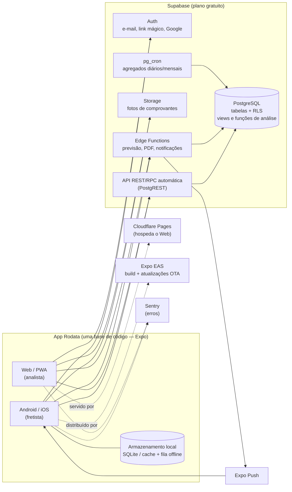
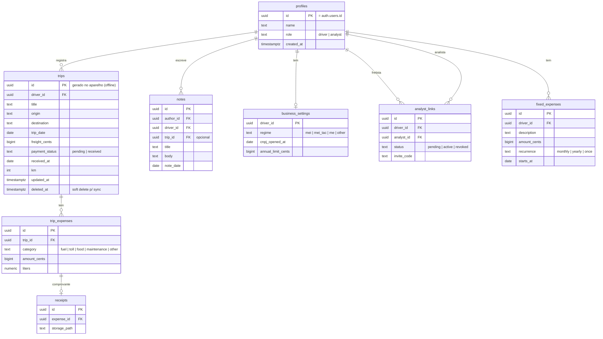

# Rodata — Requisitos, Arquitetura e Tecnologias

> Documento base do projeto. Derivado do design em Figma (`trip_dash` › seção *alta fidelidade*)
> e do briefing do produto. Versão 0.1 — 03/11/2026.

---

## 1. Visão do produto

O **Rodata** é um aplicativo **mobile e web** para fretistas autônomos e para quem cuida das
finanças deles (analista). O fretista registra cada viagem (frete recebido e custos: combustível,
pedágio, comida, manutenção), e o sistema transforma esses registros em **análises de negócio**:
receita, custos, lucro, tendências, previsões e acompanhamento do **teto do MEI**.

### 1.1 Personas

| | **Fretista** (fonte dos dados) | **Analista** (consome as análises) |
|---|---|---|
| Idade | ~50 anos | ~40 anos |
| Tecnologia | Básico: WhatsApp, Instagram, Facebook | Padrão: internet banking, faturas, redes sociais |
| Dispositivo principal | Celular Android, muitas vezes na estrada, com sinal ruim | Celular e computador |
| Objetivo | Registrar viagem/gasto **rápido**, sem errar, e ver "quanto sobrou" | Entender a saúde do negócio, comparar períodos, planejar, evitar estourar o MEI |
| Medos | Tela confusa, letra pequena, "apertar errado e perder tudo" | Dado incompleto ou errado, não perceber um problema a tempo |

### 1.2 Telas existentes no design

1. **Criar conta** — nome, e-mail, senha, confirmar senha.
2. **Login** — e-mail, senha, "esqueceu sua senha?".
3. **Home / Dashboard** — período analisado × período comparado; cards *Receita faturada* e
   *Receita total* com variação %; card *Custo* com quebra por categoria (gasolina, pedágio,
   comida); gráfico *Timeline* com filtro Dia / Semana / Mês.
4. **Lista de viagens** — abas Viagens / Anotações, filtro de período e ordenação, busca por
   nome/local, card com nome, local, data, frete e custo, botão "+".
5. **Criação da viagem** — Dados principais (nome, local, frete, data) e Custos (gasolina,
   pedágio, comida, manutenção).
6. **Lista de anotações** — busca por título, card com título, data e trecho.
7. **Criação de anotação** — título, data, texto.
8. Barra inferior: Início, Viagens, Perfil/Anotações.

---

## 2. Requisitos funcionais

Prioridade: **M** = MVP (primeira versão), **V2** = segunda entrega, **F** = futuro.

### 2.1 Conta e acesso

| ID | Requisito | Prior. |
|---|---|---|
| RF-01 | Criar conta com nome, e-mail e senha (com confirmação). | M |
| RF-02 | Login com e-mail e senha; sessão mantida no aparelho (não pedir login toda hora). | M |
| RF-03 | Recuperar senha por e-mail. | M |
| RF-04 | Login sem senha por **link mágico / código no e-mail** e **"Entrar com Google"** (reduz senha esquecida — dor comum da persona fretista). | V2 |
| RF-05 | Perfil com dois papéis: **fretista** e **analista**. | M |
| RF-06 | Fretista convida analista por **link/código compartilhável pelo WhatsApp**; analista aceita e passa a ver os dados daquele fretista. Fretista pode revogar o acesso. | M |
| RF-07 | Analista pode acompanhar **vários fretistas** e alternar entre eles. | V2 |
| RF-08 | Cadastro do negócio: tipo de enquadramento (MEI comum, **MEI Transportador Autônomo de Cargas**, ME, outro), data de abertura do CNPJ e limite anual (pré-preenchido, editável). | M |

### 2.2 Viagens (fonte principal dos dados)

| ID | Requisito | Prior. |
|---|---|---|
| RF-10 | Criar viagem com: nome/descrição, origem e destino (local), data, **valor do frete**, e custos por categoria — combustível, pedágio, alimentação, manutenção, **outros**. Só *valor do frete* e *data* são obrigatórios. | M |
| RF-11 | Campos de dinheiro com **máscara R$** automática e teclado numérico. | M |
| RF-12 | Status de recebimento do frete: **a receber / recebido** (com data de recebimento), para controlar fretes ainda não pagos (RF-48). | V2 |
| RF-13 | Editar e excluir viagem (exclusão com confirmação e opção **desfazer** por alguns segundos). | M |
| RF-14 | Listar viagens com busca por nome/local, filtro por período e ordenação por data/valor. | M |
| RF-15 | Card de viagem mostra frete, custo e a **receita faturada da viagem** (frete − custos) em destaque (verde/vermelho). | M |
| RF-16 | **Repetir viagem**: duplicar uma viagem anterior (rotas recorrentes) e só ajustar valores. | M |
| RF-17 | Funcionamento **offline**: registrar viagem sem internet e sincronizar sozinho quando voltar o sinal, com indicador claro ("salvo no celular / enviado"). | M |
| RF-18 | Anexar **foto do comprovante** (cupom de combustível, pedágio, nota) a cada custo. | V2 |
| RF-19 | Lançar **vários abastecimentos/pedágios** na mesma viagem (lista de itens de custo), mantendo a forma simples como padrão. | V2 |
| RF-20 | Registrar km inicial/final ou km rodados, litros abastecidos → calcula **R$/km** e **km/l**. | V2 |
| RF-21 | Custos fixos/mensais fora de viagem (parcela do caminhão, seguro, DAS, IPVA, rastreador). | V2 |
| RF-22 | Preenchimento por **voz** ("frete de 600 reais para Presidente Prudente"). | F |
| RF-23 | Leitura automática (OCR) do comprovante para preencher o valor. | F |

### 2.3 Anotações

| ID | Requisito | Prior. |
|---|---|---|
| RF-30 | Criar, editar, excluir anotação com título, data e texto. | M |
| RF-31 | Buscar anotações por título/conteúdo. | M |
| RF-32 | Vincular anotação a uma viagem (opcional). | V2 |
| RF-33 | Analista pode comentar/anotar sobre o mês ou viagem do fretista. | V2 |

### 2.4 Dashboard e análises

| ID | Requisito | Prior. |
|---|---|---|
| RF-40 | Seletor de **período analisado** e **período comparado** (atalhos: este mês, mês passado, últimos 3 meses, este ano, personalizado). | M |
| RF-41 | Cards: **Receita total** (soma dos fretes), **Receita faturada** (receita total − custos), **Custo total** e **Margem %** (faturada ÷ total), cada um com variação % vs. período comparado (seta + cor). Definições em §2.6. | M |
| RF-42 | Quebra de custos por categoria (barras horizontais, como no design) com valor e % do total. | M |
| RF-43 | **Timeline** de receita total × custo × receita faturada com agrupamento Dia / Semana / Mês. | M |
| RF-44 | **Termômetro do MEI**: faturamento acumulado no ano × limite, % usado, quanto falta, **média mensal máxima permitida** até dezembro e alerta quando passar de 70% / 90% / 100% / 120%. | M |
| RF-45 | **Previsão** de receita e custo para os próximos 3 meses e **projeção de fechamento do ano** (inclusive projeção de quando o teto do MEI seria atingido). Mostrar como faixa (otimista/provável/pessimista), nunca como número exato. | M |
| RF-46 | Indicadores de eficiência: ticket médio do frete, receita faturada média por viagem, nº de viagens, custo por categoria / receita, R$/km e km/l (quando houver km). | V2 |
| RF-47 | Ranking de destinos/rotas mais lucrativos e menos lucrativos. | V2 |
| RF-48 | **Valores a receber**: lista de fretes não recebidos e há quantos dias. | V2 |
| RF-49 | Lembrete mensal do **DAS do MEI** (vencimento dia 20). | V2 |
| RF-50 | Resumo em **linguagem simples** no topo para o fretista ("Este mês você lucrou R$ 3.200, R$ 400 a mais que o mês passado"). | M |
| RF-51 | Exportar relatório do período em **PDF** (para enviar pelo WhatsApp) e **CSV/Excel** (para o analista). | V2 |
| RF-52 | Notificações push: alertas do MEI, viagem sem custo lançado, frete a receber atrasado. | V2 |

### 2.5 Regras de negócio

- **RN-01 Limite do MEI** (configurável — a legislação muda):
  - MEI comum: **R$ 81.000/ano**.
  - **MEI Transportador Autônomo de Cargas (MEI caminhoneiro, LC 188/2021): R$ 251.600/ano.**
    Esse é provavelmente o caso do fretista com caminhão — confirmar o enquadramento no cadastro.
  - No **ano de abertura**, o limite é proporcional: `limite / 12 × meses desde a abertura`.
  - Até **20% acima** do limite: desenquadramento a partir do ano seguinte.
    **Mais de 20% acima**: desenquadramento retroativo a janeiro (impostos retroativos) — alerta vermelho.
  - O limite do MEI é sobre a **receita bruta** = **Receita total** (o valor cheio dos fretes), **não** sobre a
    receita faturada — os custos não abatem o limite. Data de referência: data da viagem (ou de recebimento, quando RF-12 existir).
- **RN-02 Receita total** = soma do valor do frete das viagens do período.
  **Receita faturada** = receita total − custos das viagens (combustível, pedágio, comida, manutenção, outros)
  − custos fixos do período (quando houver, V2). Pode ser negativa (mostrar em vermelho).
- **RN-03 Variação %** = `(atual − comparado) / comparado`; se o comparado for zero, mostrar "—" e não "∞".
- **RN-04 Previsão**: só exibir com pelo menos 3 meses de histórico; com menos, mostrar "Precisamos de mais
  meses de dados para prever". Com ≥ 12 meses, considerar sazonalidade.
- **RN-05 Permissões**: fretista é dono dos dados; analista vinculado tem **leitura** dos dados e escrita só em
  anotações/comentários próprios (V2: permitir que o analista também lance dados, se o fretista autorizar).
- **RN-06 Valores** armazenados em **centavos (inteiro)** para não haver erro de arredondamento.
- **RN-07 Datas** no fuso `America/Sao_Paulo`; exibição dd/mm/aaaa.

### 2.6 Definição dos indicadores de receita (confirmada com o cliente)

| Indicador | Fórmula | Exemplo |
|---|---|---|
| **Receita total** | Σ valor do frete (o que o cliente paga pela viagem) | Frete R$ 600,00 |
| **Custo** | Σ combustível + pedágio + comida + manutenção + outros | R$ 200,00 |
| **Receita faturada** | Receita total − Custo | R$ 400,00 |
| **Margem** | Receita faturada ÷ Receita total | 66,7% |

Observações:
- Os valores de exemplo do Figma (total R$ 12.000, custo R$ 3.900, faturada R$ 10.000) não fecham
  com a fórmula — são placeholders; com a regra, a faturada seria R$ 8.100.
- Em contabilidade "faturado" costuma significar "valor cobrado/nota emitida", o que pode confundir o
  analista. Sugestão: manter o rótulo **"Receita faturada"** com o subtítulo *"frete − custos"*, e na
  visão do fretista chamar de **"Sobrou"** / **"Lucro"**.
- O **termômetro do MEI usa a Receita total**, nunca a faturada (RN-01).

---

## 3. Requisitos não funcionais

### 3.1 Usabilidade e acessibilidade (prioridade máxima — foco no usuário)

| ID | Requisito |
|---|---|
| RNF-01 | Fonte base **≥ 16 px** (corpo) e **≥ 18 px** nos campos de valor; respeitar o tamanho de fonte do sistema (Dynamic Type / escala de fonte do Android) sem quebrar layout. |
| RNF-02 | Áreas de toque **≥ 48 × 48 dp**; botões principais largos, na zona do polegar (parte de baixo da tela). |
| RNF-03 | Contraste **WCAG 2.2 AA** (≥ 4.5:1). O laranja do design (#E8572A aprox.) deve ser validado com texto branco — usar um tom mais escuro para texto se necessário. Nunca transmitir informação **só por cor** (variação % sempre com seta + sinal). |
| RNF-04 | Ícones **sempre com texto** (a barra inferior hoje tem só ícones → adicionar rótulos "Início", "Viagens", "Anotações"). |
| RNF-05 | Lançar uma viagem em **≤ 30 segundos** e **≤ 3 toques** após abrir o app (botão "+ Nova viagem" fixo na Home). |
| RNF-06 | Linguagem do dia a dia: "Lucro", "Gastos", "Quanto falta para o limite do MEI" — evitar termos como "margem bruta" na visão do fretista. A visão do analista pode ser mais técnica. |
| RNF-07 | Feedback claro em toda ação (toast "Viagem salva ✓"), confirmação antes de excluir, possibilidade de desfazer. |
| RNF-08 | Mensagens de erro em português, dizendo **o que fazer** ("Digite o valor do frete"), ao lado do campo. |
| RNF-09 | Onboarding de no máximo 3 passos e dados de exemplo opcionais para "ver como fica". |
| RNF-10 | Tema claro como padrão; modo escuro opcional. |

### 3.2 Desempenho

| ID | Requisito |
|---|---|
| RNF-20 | Dashboard carregado em **< 1 s** em 4G (p95) e exibido **instantaneamente** a partir do cache local ao abrir o app (atualiza em segundo plano). |
| RNF-21 | Agregações calculadas **no banco** (views/funções SQL + índices), retornando apenas números já somados — o app nunca baixa todas as viagens para somar. |
| RNF-22 | Web: LCP < 2,5 s, bundle inicial < 250 kB gzip; listas virtualizadas e paginadas. |
| RNF-23 | Imagens de comprovantes comprimidas no aparelho (≤ 300 kB, WebP/JPEG) antes do upload. |

### 3.3 Confiabilidade, segurança e LGPD

| ID | Requisito |
|---|---|
| RNF-30 | Offline-first no mobile, sem perda de dados (fila de envio persistente). |
| RNF-31 | Isolamento de dados por usuário com **Row Level Security** no Postgres (fretista só vê o seu; analista só vê fretistas que o convidaram). |
| RNF-32 | HTTPS em tudo; senhas gerenciadas pelo provedor de autenticação (nunca armazenadas pela aplicação). |
| RNF-33 | **LGPD**: termo de uso e política de privacidade no cadastro, exportação dos próprios dados e **exclusão de conta** (também exigido pelas lojas de apps). |
| RNF-34 | Backup diário do banco (exportação automática via GitHub Actions para armazenamento externo, pois o plano gratuito não oferece restauração point-in-time). |

### 3.4 Custo e operação

| ID | Requisito |
|---|---|
| RNF-40 | Hospedagem **R$ 0/mês** na fase inicial (planos gratuitos — ver §5.4). |
| RNF-41 | Deploy automático a cada push (CI/CD) e monitoramento de erros gratuito. |
| RNF-42 | Uma única base de código para Android, iOS e Web. |

---

## 4. Arquitetura

### 4.1 Visão geral

Arquitetura **serverless / BaaS**: um app universal (Expo) conversa diretamente com o **Supabase**
(Postgres + Auth + Storage + Edge Functions). A regra de negócio de leitura (análises) vive em
**funções SQL** no Postgres — rápidas, perto dos dados e sem servidor para manter.



### 4.2 Por que essa arquitetura

- **Um código só para mobile e web** (Expo + React Native Web): o fretista usa o app instalado no
  celular (funciona offline, ícone na tela inicial como o WhatsApp); o analista usa o mesmo app no
  navegador do computador, com layout responsivo de dashboard.
- **Sem servidor próprio**: Supabase entrega banco, autenticação, API e storage prontos — menos código,
  menos custo, menos coisas para quebrar.
- **Análises no banco**: somas, agrupamentos por dia/semana/mês e comparativos são feitos em SQL com
  índices; o app recebe poucos bytes → resposta rápida mesmo em 4G ruim.
- **Segurança declarativa**: RLS garante no próprio banco que cada um só vê o que pode.

### 4.3 Modelo de dados (inicial)



Índices principais: `trips (driver_id, trip_date)`, `trips (driver_id, received_at)`,
`trip_expenses (trip_id)`, busca textual com `pg_trgm` em `trips.title/destination` e `notes.title/body`.

### 4.4 Camada de análise (no Postgres)

| Objeto | Tipo | Retorna |
|---|---|---|
| `dashboard_summary(driver, inicio, fim, cmp_inicio, cmp_fim)` | função RPC | receita total, custos por categoria, receita faturada (total − custos), margem e variações % — **uma chamada para o topo do dashboard** |
| `timeline(driver, inicio, fim, granularidade)` | função RPC | série `date_trunc('day'/'week'/'month')` de receita total, custo e receita faturada |
| `mei_status(driver, ano)` | função RPC | acumulado no ano (por recebimento), limite (proporcional se ano de abertura), % usado, quanto falta, média mensal permitida, faixa de alerta |
| `monthly_aggregates` | tabela/visão materializada atualizada por `pg_cron` + gatilho | totais mensais por fretista — base barata para previsão e gráficos longos |
| `forecast` | Edge Function | previsão 3 meses + fechamento do ano |

**Previsão (RF-45) — abordagem simples e explicável:**
1. Menos de 3 meses → não prevê (RN-04).
2. 3 a 11 meses → média móvel ponderada + tendência linear (regressão sobre `monthly_aggregates`), faixa = ± desvio padrão.
3. 12+ meses → **Holt-Winters** (suavização exponencial com sazonalidade anual), faixa = intervalo de previsão.
4. Projeção do MEI: `acumulado_no_ano + soma(previsão dos meses restantes)` → "No ritmo atual, você chega a ~X% do limite em dezembro" e "o limite seria atingido em *mês*".

Tudo roda em TypeScript na Edge Function (sem dependência de serviço pago de ML) e o resultado
fica em cache por fretista/mês, recalculado quando entra viagem nova.

### 4.5 Offline e sincronização

- IDs das viagens gerados no aparelho (UUID v7) → criação offline sem conflito.
- MVP: **TanStack Query** com cache persistido + **fila de mutações persistida** (reexecuta ao reconectar);
  dashboard abre com o último resultado em cache.
- Conflitos: "última edição vence" via `updated_at`; exclusão como *soft delete* (`deleted_at`).
- Evolução (se o uso offline crescer): **PowerSync** ou **Legend-State** sobre SQLite local sincronizando com o Supabase.

### 4.6 Estrutura do repositório

```
rodata/
├─ app/                     # rotas (Expo Router) — mesmo código p/ mobile e web
│  ├─ (auth)/login.tsx, cadastro.tsx
│  ├─ (tabs)/index.tsx      # dashboard
│  ├─ (tabs)/viagens/…      # lista, nova, [id]
│  └─ (tabs)/anotacoes/…
├─ src/
│  ├─ components/           # UI (botões grandes, InputMoeda, CardKPI, Termometro MEI…)
│  ├─ features/             # trips, notes, dashboard, mei, auth (hooks + schemas Zod)
│  ├─ lib/                  # supabase client, query client, formatadores (R$, datas)
│  └─ theme/                # tokens do design (cores, tipografia, espaçamento)
├─ supabase/
│  ├─ migrations/           # SQL versionado (tabelas, RLS, funções de análise)
│  ├─ functions/            # Edge Functions (forecast, pdf, push)
│  └─ seed.sql
├─ docs/
└─ .github/workflows/       # CI: lint, testes, deploy web, backup, keep-alive
```

---

## 5. Tecnologias

### 5.1 Front-end (mobile + web)

| Tecnologia | Uso | Por quê |
|---|---|---|
| **Expo SDK (última estável) + React Native** (New Architecture) | App Android/iOS/Web | Padrão de mercado para React Native; uma base de código; builds e atualizações OTA sem loja |
| **TypeScript** | Linguagem | Segurança de tipos ponta a ponta (tipos gerados do banco com `supabase gen types`) |
| **Expo Router** | Navegação | Rotas por arquivo, deep links (convite do analista por link), URLs reais na web |
| **NativeWind v4 (Tailwind CSS)** + componentes próprios acessíveis | Estilo / design system | Mesmo vocabulário Tailwind do mercado, funciona em mobile e web; tokens do Figma viram tema |
| **TanStack Query v5** | Dados remotos, cache, offline | Cache persistente, retry, mutações offline, atualização em segundo plano |
| **Zustand** | Estado local leve (filtros, período selecionado) | Simples, sem boilerplate |
| **React Hook Form + Zod** | Formulários e validação | Mesmo schema valida no app e na Edge Function |
| **react-native-gifted-charts** (mobile+web via react-native-svg) | Gráficos | Área/linha/barras como no design, funciona nas 3 plataformas |
| **react-native-mask-input** / formatação `Intl.NumberFormat('pt-BR')` | Máscara de R$ e datas | Entrada de dinheiro sem erro |
| **date-fns** (locale pt-BR) | Datas | Leve, tree-shakeable |
| **expo-image-picker + expo-image-manipulator** | Foto e compressão de comprovante | Nativo do Expo |
| **expo-notifications** | Push | Grátis via Expo Push Service |
| **expo-sqlite / AsyncStorage** | Persistência local | Cache e fila offline |

### 5.2 Back-end

| Tecnologia | Uso |
|---|---|
| **Supabase** | Postgres gerenciado, Auth, API REST/RPC automática, Storage, Edge Functions, Realtime |
| **PostgreSQL 15+** | Dados, **RLS**, funções de análise, `pg_trgm` (busca), `pg_cron` (agregados) |
| **Supabase Edge Functions (Deno/TypeScript)** | Previsão, geração de PDF, envio de push, validações sensíveis |
| **Supabase CLI** | Migrations versionadas, ambiente local com Docker, geração de tipos |

### 5.3 Qualidade e DevOps

| Tecnologia | Uso |
|---|---|
| **GitHub Actions** | CI (lint, typecheck, testes), deploy do web, backup diário do banco, *keep-alive* do Supabase |
| **Biome** (ou ESLint + Prettier) | Lint/format |
| **Vitest** + **React Native Testing Library** | Testes unitários (cálculos de MEI, previsão, formatação de R$) e de componentes |
| **pgTAP** | Testes das políticas RLS e das funções SQL |
| **Maestro** (mobile) / **Playwright** (web) | Testes E2E dos fluxos críticos: cadastrar, lançar viagem offline, ver dashboard |
| **Sentry** (plano free) | Erros e performance |
| **PostHog** (plano free) | Analytics de uso e funis (onde o fretista desiste do cadastro de viagem) |

### 5.4 Hospedagem gratuita

| Serviço | Plano gratuito (referência — confirmar limites atuais) | Observação |
|---|---|---|
| **Supabase** | ~500 MB de banco, 1 GB de storage, 50 mil usuários ativos/mês, Edge Functions incluídas | Projeto **pausa após ~7 dias sem acesso** → workflow do GitHub Actions faz uma consulta diária (*keep-alive*). Sem backup PITR → backup próprio (RNF-34). |
| **Cloudflare Pages** | Banda ilimitada, builds grátis, permite uso comercial | Hospeda o build web estático do Expo (`expo export -p web`). Alternativa: Vercel Hobby (apenas uso não comercial). |
| **Expo EAS** | Builds mensais gratuitos + atualizações OTA | Distribuição Android por **APK com link** (gratuito, pode ser enviado pelo WhatsApp) |
| **Expo Push** | Gratuito | Notificações |
| **Sentry / PostHog** | Planos free | Monitoramento |
| **GitHub** | Repositório + Actions gratuitos | CI/CD |

**Estimativa de capacidade:** uma viagem com custos ocupa ~1 kB; 500 MB comportam centenas de
milhares de viagens — folga para muitos fretistas por anos. O gargalo real é storage de fotos
(1 GB ≈ 3.000+ comprovantes comprimidos) → por isso a compressão (RNF-23).

**Custos que não são de hospedagem:** publicar na **Google Play** custa US$ 25 (taxa única) e na
**App Store** US$ 99/ano. Até lá: Android via APK por link e iPhone via **PWA** (web app adicionado à
tela inicial).

---

## 6. Diretrizes de UI para as personas (ajustes sugeridos ao design)

1. **Home do fretista ≠ Home do analista.** Fretista: um card grande "Sobrou este mês" (receita faturada), termômetro do MEI,
   botão enorme **"+ Nova viagem"**, últimas viagens. Analista: dashboard completo (comparativos,
   timeline, previsões), aproveitando a largura da tela no computador.
2. **Barra inferior com rótulos** (Início · Viagens · Anotações · Perfil) e o "+" central em destaque.
3. **Formulário de viagem em blocos grandes**, valores com R$ automático, data já preenchida com hoje,
   custos opcionais e um campo "Outros". Botão "Salvar viagem" sempre visível.
4. **Período em linguagem natural**: botões "Este mês", "Mês passado", "Este ano" antes do calendário.
5. **Gráfico simples** para o fretista (barras por mês: recebeu × gastou); área/linha detalhada para o analista.
   Remover as legendas de exemplo do Figma (Figma/Sketch/XD) e usar Receita total / Custo / Receita faturada.
6. **Cores com significado consistente**: verde = lucro/aumento bom, vermelho = gasto/queda, laranja Rodata =
   ações principais. Variações sempre com seta e sinal (+/−).
7. **Estados vazios que ensinam**: "Você ainda não lançou viagens este mês. Toque em + para começar."

---

## 7. Roadmap sugerido

| Fase | Entregas |
|---|---|
| **0 — Fundação** (1 sem.) | Repositório, Expo + Supabase, migrations, RLS, CI/CD, design tokens do Figma |
| **1 — MVP fretista** (3–4 sem.) | Auth, cadastro do negócio (MEI), CRUD de viagens com offline, anotações, Home simples com receita faturada do mês e termômetro do MEI |
| **2 — MVP analista** (2–3 sem.) | Convite por link, dashboard completo (comparativos, custos por categoria, timeline), previsão e projeção do MEI, versão web publicada |
| **3 — V2** | Comprovantes com foto, custos fixos, km/consumo, a receber, PDF/CSV, push, lembrete do DAS, vários fretistas por analista |
| **4 — Futuro** | Voz, OCR de comprovante, publicação nas lojas |

## 8. Critérios de aceite do MVP (resumo)

- Fretista de primeira viagem consegue criar conta e lançar uma viagem **sem ajuda** em teste com usuário real.
- Viagem lançada em modo avião aparece no dashboard do analista minutos depois de o celular reconectar.
- Dashboard abre em < 1 s com cache e confere, centavo a centavo, com a soma das viagens do período.
- Termômetro do MEI calcula corretamente o limite proporcional no ano de abertura e os alertas de 20%.
- Analista não consegue, por nenhuma chamada de API, ler dados de um fretista que não o convidou (teste pgTAP).
